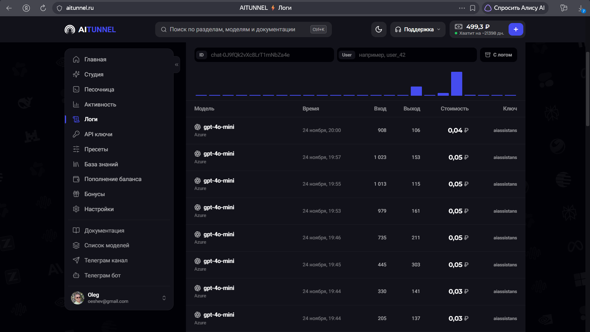

# Telegram-бот с AITUNNEL

Telegram-бот на **aiogram 3.x**, который ведёт диалог с моделью через
OpenAI-совместимый прокси **AITUNNEL**. История переписки хранится в памяти
процесса, секреты — только в `.env`, все запросы и usage логируются.

## Возможности

- команда `/start` — приветствие и инструкция;
- команда `/reset` — очистка контекста текущего пользователя;
- ответы на текстовые сообщения и подписи к медиа с учётом последних
  `MAX_HISTORY_MESSAGES` сообщений;
- опциональный `SYSTEM_PROMPT`, allowlist (`ALLOWED_USER_IDS`) и rate limit;
- история сохраняется в `data/contexts.json` при `PERSIST_CONTEXT=true`;
- модель, temperature, `max_tokens`, лимит истории и таймаут настраиваются
  через `.env`;
- логи в консоль и в `logs/bot.log` с ротацией (5 МБ × 3 файла);
- в логах есть `user_id`, параметры запроса, токены, `cost_rub`, `balance`
  и `request_id`, но нет токена бота и API-ключа;
- длинные ответы автоматически делятся на несколько сообщений Telegram
  с учётом лимита UTF-16.

## Стек

- Python 3.10+;
- [aiogram](https://docs.aiogram.dev/) 3.x;
- [openai](https://github.com/openai/openai-python) (`AsyncOpenAI`);
- `python-dotenv`;
- стандартный `logging` + `RotatingFileHandler`.

## Структура проекта

```text
project/
├── bot.py              # точка входа, хендлеры и polling
├── config.py           # чтение .env, валидация, настройка logging
├── context_manager.py  # история диалогов (+ JSON на диск)
├── api_client.py       # AsyncOpenAI и вызов AITUNNEL
├── .env.example        # шаблон переменных окружения
├── .gitignore
├── requirements.txt
├── README.md
├── data/               # contexts.json при PERSIST_CONTEXT=true
└── logs/               # создаётся автоматически при старте
```

## Быстрый старт

### 1. Клонировать проект и перейти в каталог

```bash
git clone <URL-репозитория>
cd project
```

### 2. Создать виртуальное окружение (рекомендуется)

Windows (PowerShell):

```powershell
python -m venv venv
.\venv\Scripts\Activate.ps1
```

Linux/macOS:

```bash
python3 -m venv venv
source venv/bin/activate
```

### 3. Установить зависимости

```bash
pip install -r requirements.txt
```

### 4. Создать `.env` и заполнить ключи

Windows:

```powershell
Copy-Item .env.example .env
```

Linux/macOS:

```bash
cp .env.example .env
```

Откройте `.env` и укажите:

```dotenv
BOT_TOKEN=123456789:AA...ваш_токен_от_BotFather
AITUNNEL_API_KEY=sk-aitunnel-...
AITUNNEL_BASE_URL=https://api.aitunnel.ru/v1/
```

`BOT_TOKEN` и `AITUNNEL_API_KEY` обязательны. Если оставить заглушки из
`.env.example`, при запуске будет понятная ошибка `ConfigError` с указанием
проблемной переменной.

### 5. Запустить бота

```bash
python bot.py
```

При первом запуске автоматически создаётся каталог `logs/` и файл
`logs/bot.log`. Остановка — `Ctrl+C`.

## Переменные окружения

| Переменная | Обязательна | По умолчанию | Назначение |
|---|---:|---|---|
| `BOT_TOKEN` | да | — | токен Telegram-бота от BotFather |
| `AITUNNEL_API_KEY` | да | — | ключ AITUNNEL, передаётся как Bearer |
| `AITUNNEL_BASE_URL` | нет | `https://api.aitunnel.ru/v1/` | base URL OpenAI-совместимого API |
| `DEFAULT_MODEL` | нет | `gpt-4o-mini` | модель или слаг OpenRouter |
| `DEFAULT_TEMPERATURE` | нет | `0.7` | температура, от `0.0` до `2.0` |
| `DEFAULT_MAX_TOKENS` | нет | `512` | максимум токенов в ответе |
| `MAX_HISTORY_MESSAGES` | нет | `10` | сколько последних сообщений хранить |
| `LOG_LEVEL` | нет | `INFO` | `DEBUG`/`INFO`/`WARNING`/`ERROR`/`CRITICAL` |
| `AITUNNEL_TIMEOUT_SECONDS` | нет | `60` | таймаут запроса, секунды |
| `AITUNNEL_MAX_RETRIES` | нет | `2` | повторы запроса на уровне OpenAI SDK |
| `MESSAGE_CHUNK_SIZE` | нет | `4096` | длина части длинного ответа (UTF-16) |
| `SYSTEM_PROMPT` | нет | краткий ассистент | system-сообщение для модели; пусто = без него |
| `ALLOWED_USER_IDS` | нет | пусто | Telegram id через запятую; пусто = доступ всем |
| `RATE_LIMIT_SECONDS` | нет | `2` | пауза между запросами к модели на пользователя; `0` = выкл |
| `PERSIST_CONTEXT` | нет | `true` | сохранять историю в JSON между перезапусками |
| `CONTEXT_FILE` | нет | `data/contexts.json` | путь к файлу истории |

Значение `MAX_HISTORY_MESSAGES=10` означает 10 отдельных сообщений, то есть
примерно 5 пар «вопрос — ответ» (минимум — `2`). Лимит применяется после
каждого добавления: всегда остаётся только связный хвост истории.

## Команды бота

| Команда | Действие |
|---|---|
| `/start` | приветствие и инструкция по использованию |
| `/reset` | полностью очищает историю текущего `user_id` |
| `/help` | список доступных команд |
| любой текст | добавляет сообщение в историю, вызывает AITUNNEL и отвечает |

Список команд также публикуется в меню Telegram (`set_my_commands`) при старте бота.

Контекст разделён по `user_id`. При `PERSIST_CONTEXT=true` он пишется в
`CONTEXT_FILE` и переживает перезапуск; `/reset` очищает и файл. Для
нескольких воркеров одного бота всё ещё нужна общая БД (Redis, PostgreSQL).

## Как устроен вызов AITUNNEL

`api_client.py` создаёт один `AsyncOpenAI` на процесс:

```python
client = AsyncOpenAI(
    api_key=config.AITUNNEL_API_KEY,
    base_url=config.AITUNNEL_BASE_URL,
    timeout=config.AITUNNEL_TIMEOUT_SECONDS,
    max_retries=config.AITUNNEL_MAX_RETRIES,
)
```

Далее выполняется обычный OpenAI Chat Completions:

```python
completion = await client.chat.completions.create(
    model=model,
    messages=messages,
    temperature=temperature,
    max_tokens=max_tokens,
)
```

Ключ передаётся SDK как `Authorization: Bearer sk-aitunnel-...`; отдельный
HTTP-клиент или нестандартные заголовки не нужны.

### request_id

AITUNNEL возвращает `X-Request-Id` в каждом ответе. OpenAI SDK сохраняет его
в `_request_id` объекта ответа; для ошибок используется `error.request_id`.
Клиент дополнительно умеет читать заголовок `X-Request-Id` из HTTP-ответа.
Значение пишется в лог и возвращается из `get_completion()` в поле
`request_id`.

### Стоимость и баланс

В `usage` AITUNNEL дополнительно приходят поля:

- `cost_rub` — стоимость запроса в рублях;
- `cost` — то же самое число в рублях;
- `balance` — баланс после запроса.

Они не входят в стандартную схему OpenAI, поэтому читаются через
`getattr()`/`model_extra`. Если `cost_rub` отсутствует, клиент подставляет
`cost`. **Все стоимости в этом README и в логах указаны в рублях (₽);
источник — `usage.cost_rub` из ответа AITUNNEL.**

### Модели

В `DEFAULT_MODEL` можно указывать как короткое имя (`gpt-4o-mini`), так и
слаг OpenRouter (`anthropic/claude-sonnet-4.6`), если модель доступна в
тарифе AITUNNEL.

## Логирование

Формат строки:

```text
%(asctime)s | %(levelname)s | %(name)s | %(message)s
```

Настройки:

- консоль + `logs/bot.log`;
- `RotatingFileHandler`, 5 МБ на файл, 3 архивные копии;
- кодировка UTF-8;
- уровень из `LOG_LEVEL`.

Логируются:

- старт и остановка бота, результат авторизации;
- входящее сообщение: `user_id`, длина текста, команда (без самого текста);
- параметры запроса: `user_id`, `model`, `temperature`, `max_tokens`,
  `history_length`;
- usage: `prompt_tokens`, `completion_tokens`, `total_tokens`, `cost_rub`,
  `cost`, `balance`, `request_id`;
- ошибки с полным стектрейсом (`logger.exception`) и `request_id`, если он есть.

`BOT_TOKEN` и `AITUNNEL_API_KEY` не логируются. В `config.Settings` оба поля
исключены из `repr`, чтобы секреты не попали в отладочный вывод.

### Пример фрагмента лога

Ниже — **пример формата с условными значениями**, а не результат реального
прогона. Секретов в строке нет:

```text
2026-01-01 12:00:00 | INFO | bot | Incoming message: user_id=123456789 text_length=18 command=None
2026-01-01 12:00:00 | INFO | api_client | AITUNNEL request: user_id=123456789 model=gpt-4o-mini temperature=0.2 max_tokens=256 history_length=2
2026-01-01 12:00:01 | INFO | api_client | AITUNNEL usage: user_id=123456789 prompt_tokens=42 completion_tokens=87 total_tokens=129 cost_rub=0.0123 cost=0.0123 balance=499.9877 request_id=req_01HZXEXAMPLE
```

Для получения ID реальных запросов:

```powershell
Select-String -Path .\logs\bot.log -Pattern "request_id="
```

```bash
grep "request_id=" logs/bot.log
```

## Эксперименты

### Статус

Прогоны выполнены **24.11.2026** через Telegram-бота и AITUNNEL
(`gpt-4o-mini`). Для каждого режима менялись `DEFAULT_TEMPERATURE` и
`DEFAULT_MAX_TOKENS` в `.env`, бот перезапускался. Значения токенов и
стоимости взяты из `logs/bot.log` (строки `AITUNNEL usage`) и сверены со
скрином кабинета AITUNNEL.

Типовой запрос в диалоге — короткая творческая история (робот / бытовой
сюжет). `prompt_tokens` растут вместе с историей диалога
(`MAX_HISTORY_MESSAGES=10` + `SYSTEM_PROMPT`), поэтому сравнивать лучше
прежде всего по `completion_tokens` и качеству ответа.

### Таблица экспериментов

| № | Модель | Temperature | Max_tokens | Эффект (сжатость/креатив) | Токены (prompt + completion = total) | Стоимость (₽) | request_id |
|---|---|---:|---:|---|---|---:|---|
| 1 | gpt-4o-mini | 0.2 | 256 | Ответ сдержанный и предсказуемый; уложился в лимит, без «воды» | 196 + 119 = **315** | 0.02 | `chat-035392ewMDAhWpYMEbU3ih` |
| 2 | gpt-4o-mini | 0.5 | 512 | Заметно длиннее и образнее; богаче детали, больше вариативности | 445 + 303 = **748** | 0.05 | `chat-03539FUdfsMOEn6h230YUe` |
| 3 | gpt-4o-mini | 1.0 | 1024 | Высокая вариативность; длинный ответ при большом контексте в prompt | 979 + 161 = **1140** | 0.05 | `chat-03539Rnn9gLns9z3GSnJrd` |

Вывод: при росте temperature и `max_tokens` ответы становятся длиннее и
свободнее (прогон 1 → 2: completion 119 → 303). В прогоне 3 основной вклад
в `total_tokens` дал раздутый prompt из истории; completion остался
умеренным (161), а стоимость совпала с прогоном 2 (0.05 ₽) из‑за тарификации
AITUNNEL.

### Пояснение к эффектам

- **Temperature** управляет случайностью выбора следующего токена. При
  низких значениях (0.0–0.3) ответы стабильнее, суше и ближе к наиболее
  вероятным формулировкам. При 0.7–1.0 речь становится разнообразнее; при
  значениях выше 1.1 растёт риск нелогичных поворотов и потери связности.
- **Max_tokens** ограничивает длину ответа, а не «качество» напрямую. Малое
  значение (256) обрезает рассуждение и заставляет модель быть лаконичной;
  большое (1024) даёт место для деталей, но при низкой temperature может
  привести к повторам и «воде». Обрезка по лимиту может завершить ответ на
  середине мысли — это нормальное поведение API.
- **Связность** в этом боте дополнительно поддерживается историей: бот
  передаёт последние `MAX_HISTORY_MESSAGES` сообщений. Чем длиннее история,
  тем больше `prompt_tokens` и стоимость каждого следующего запроса, поэтому
  лимит истории — это ещё и инструмент контроля расходов.
- Стоимость зависит от модели и числа токенов. Сравнивать прогоны корректно
  при одинаковом запросе и одинаковом лимите истории; смотрите `cost_rub`
  в `usage`, а не только на длину ответа.

## Скриншот usage и ID запросов

Кабинет [aitunnel.ru](https://aitunnel.ru/) → раздел **«Логи»** после прогонов
(баланс ≈ 499.3 ₽). На скрине видны те же запросы `gpt-4o-mini`, что и в
таблице выше (вход/выход/стоимость совпадают с `usage` в `logs/bot.log`).



Примеры `request_id` из логов бота:

| Режим | request_id |
|---|---|
| temperature=0.2, max_tokens=256 | `chat-035392ewMDAhWpYMEbU3ih` |
| temperature=0.5, max_tokens=512 | `chat-03539FUdfsMOEn6h230YUe` |
| temperature=1.0, max_tokens=1024 | `chat-03539Rnn9gLns9z3GSnJrd` |

Полный список ID:

```powershell
Select-String -Path .\logs\bot.log -Pattern "request_id="
```

```bash
grep "request_id=" logs/bot.log
```

## Возможные проблемы

| Симптом | Что проверить |
|---|---|
| `ConfigError: Не задана ... BOT_TOKEN` | создан ли `.env` рядом с `bot.py`, заполнен ли токен |
| `ConfigError: ... значение-заглушку` | заменены ли значения из `.env.example` на реальные |
| `401 Unauthorized` от AITUNNEL | правильность `AITUNNEL_API_KEY`, баланс и доступ к модели |
| `404 model not found` | имя модели/слаг и доступность модели в AITUNNEL |
| `TelegramConflictError` | не запущены ли два экземпляра бота с одним токеном |
| Ответ не приходит, в логе таймаут | сеть/прокси, `AITUNNEL_TIMEOUT_SECONDS` |
| Бот отвечает «Не удалось получить ответ…» | полный стектрейс и `request_id` в `logs/bot.log` |

## Безопасность

- `.env` и `logs/` добавлены в `.gitignore`;
- ключи не хардкодятся и не выводятся в лог;
- в логи попадает только длина сообщения, но не его текст;
- при публикации отчёта проверьте, что в скриншоте и логе нет ключей и
  персональных данных.
